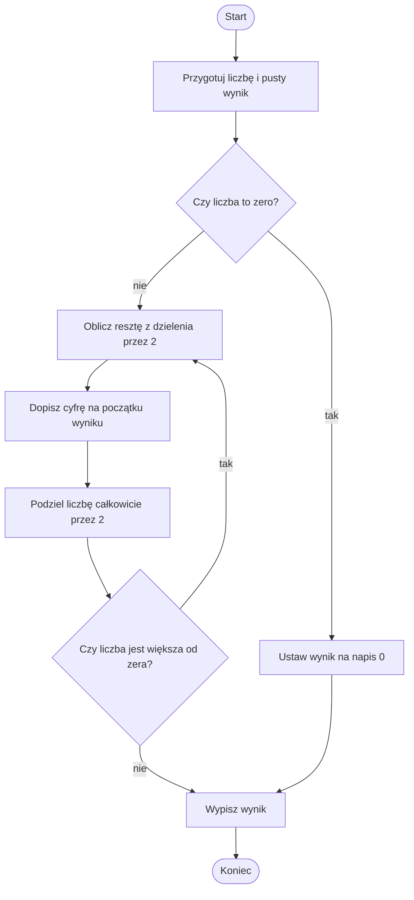

# System dziesiętny na dwójkowy

## Cel lekcji

Samodzielnie zapiszesz nieujemną liczbę całkowitą w systemie dwójkowym. Najpierw wykonasz dzielenia ręcznie, potem zapiszesz ten sam sposób w Pythonie.

## Problem po ludzku

System dziesiętny korzysta z dziesięciu cyfr: od `0` do `9`. System dwójkowy ma tylko dwie cyfry: `0` i `1`. Zmiana systemu nie zmienia wartości liczby. Zmienia sposób jej zapisania.

`13` dziesiętnie => `1101` dwójkowo.

Program będzie przyjmował nieujemną liczbę całkowitą. Przy `int(input())` zakładamy poprawnie wpisaną liczbę całkowitą. Liczbę ujemną odrzucamy. Nie korzystamy z gotowej konwersji przez `bin()` ani `format()`.

## Przykład ręczny: 13

Dzielimy przez `2`. Zapisujemy iloraz całkowity i resztę.

| Liczba | Dzielenie z resztą | Iloraz | Reszta |
| --- | --- | --- | --- |
| 13 | 13 = 6 * 2 + 1 | 6 | 1 |
| 6 | 6 = 3 * 2 + 0 | 3 | 0 |
| 3 | 3 = 1 * 2 + 1 | 1 | 1 |
| 1 | 1 = 0 * 2 + 1 | 0 | 1 |

Reszty otrzymujemy w kolejności `1`, `0`, `1`, `1`. Odczytane od końca tworzą `1101`.

Dlaczego od końca? Pierwsza reszta opisuje najmniej znaczącą pozycję, czyli miejsce jedności. Następna dotyczy pozycji dwójek, potem czwórek i ósemek. W zwykłym zapisie najbardziej znaczące cyfry stoją po lewej stronie.

Każdą liczbę nieujemną można podzielić na pełne dwójki i resztę `0` albo `1`. Dlatego reszty pasują do cyfr systemu dwójkowego.

## Budowanie wyniku

Wynik przechowamy jako napis. Zaczynamy od pustego napisu `""`. Zapis `wynik = str(reszta) + wynik` dokleja nową cyfrę **przed** dotychczasowym wynikiem.

`str(reszta)` zamienia liczbę `0` lub `1` na tekst. Znak `+` łączy dwa napisy. Nie dodaje tutaj liczb.

| Reszta | Dotychczasowy wynik | Nowy wynik |
| --- | --- | --- |
| 1 | `""` | `"1"` |
| 0 | `"1"` | `"01"` |
| 1 | `"01"` | `"101"` |
| 1 | `"101"` | `"1101"` |

Kolejność składników jest ważna. Dopisywanie reszty na końcu dałoby odwróconą kolejność cyfr.

## Algorytm słownie

1. Odrzuć liczbę ujemną.
2. Przygotuj pusty wynik i kopię liczby.
3. Dla zera ustaw wynik na napis `"0"`.
4. Dopóki kopia jest dodatnia, oblicz resztę z dzielenia przez `2`.
5. Dopisz znak tej reszty na początku wyniku.
6. Zastąp kopię jej ilorazem całkowitym przez `2`.
7. Po zakończeniu pętli wypisz wynik.

## Schemat dla danych nieujemnych



## Implementacja w Pythonie

Dane przykładowe: `13`.

<details markdown="1">
<summary>Pokaż implementację - dziesiętny na dwójkowy</summary>

```python
liczba = int(input())
if liczba < 0:
    print("Błąd danych")
else:
    pozostalaLiczba = liczba
    wynik = ""
    if pozostalaLiczba == 0:
        wynik = "0"
    while pozostalaLiczba > 0:
        reszta = pozostalaLiczba % 2
        wynik = str(reszta) + wynik
        pozostalaLiczba = pozostalaLiczba // 2
    print(wynik)
```

Wynik:

```text
1101
```

</details>

## Wyjaśnienie kodu i przypadki brzegowe

`% 2` wyznacza cyfrę, a `// 2` przygotowuje liczbę do następnego obiegu. Dodatni iloraz jest mniejszy od poprzedniej liczby. W końcu staje się zerem, więc pętla kończy działanie.

Dla zera pętla nie wykona się ani razu. Bez osobnej instrukcji wynik pozostałby pusty. Poprawny zapis zera to `0`.

| Dane dziesiętne | Wynik dwójkowy | Co warto zauważyć? |
| --- | --- | --- |
| 0 | `0` | jeden znak, nie pusty napis |
| 1 | `1` | jedno dzielenie |
| 6 | `110` | liczba parzysta kończy się zerem |
| 13 | `1101` | liczba nieparzysta kończy się jedynką |
| 16 | `10000` | potęga dwójki: jedynka i kolejne zera |

Kolejne potęgi dwójki to `1`, `2`, `4`, `8`, `16`. Każda następna jest dwa razy większa od poprzedniej. Ich zapisy to `1`, `10`, `100`, `1000`, `10000`.

## Typowe błędy

- Dopisywanie reszt w niewłaściwym miejscu napisu.
- Mieszanie liczby i napisu bez `str()`.
- Dzielenie przez `10` zamiast przez `2`.
- Zwykłe dzielenie `/` zamiast całkowitego `//`.
- Brak aktualizacji liczby w pętli.
- Uznanie pustego wyniku za zapis zera.

## Ćwiczenia

### Ćwiczenie 1. Sześć ręcznie

Przelicz ręcznie `6` na system dwójkowy. Zapisz ilorazy i reszty. Nie uruchamiaj programu przed własnym obliczeniem.

<details markdown="1">
<summary>Podpowiedź do ćwiczenia 1</summary>

Pierwsza reszta należy do prawej strony wyniku. Pilnuj kierunku odczytu.

</details>

<details markdown="1">
<summary>Rozwiązanie ćwiczenia 1</summary>

| Liczba | Iloraz przez 2 | Reszta |
| --- | --- | --- |
| 6 | 3 | 0 |
| 3 | 1 | 1 |
| 1 | 0 | 1 |

Reszty od końca => `110`.

</details>

### Ćwiczenie 2. Sprawdź zero

Napisz program konwersji nieujemnej liczby dziesiętnej na dwójkową. Sprawdź `0` i `1`. Zero nie może dawać pustego napisu.

<details markdown="1">
<summary>Podpowiedź do ćwiczenia 2</summary>

Zastanów się, czy warunek pętli jest prawdziwy dla zera. Jeśli nie, wynik trzeba przygotować przed pętlą.

</details>

<details markdown="1">
<summary>Rozwiązanie ćwiczenia 2</summary>

```python
liczba = int(input())
if liczba < 0:
    print("Błąd danych")
else:
    wynik = ""
    pozostalaLiczba = liczba
    if pozostalaLiczba == 0:
        wynik = "0"
    while pozostalaLiczba > 0:
        wynik = str(pozostalaLiczba % 2) + wynik
        pozostalaLiczba = pozostalaLiczba // 2
    print(wynik)
```

Dla danych `0` wynik:

```text
0
```

Dla danych `1` wynik to `1`.

</details>

### Ćwiczenie 3. Trzy kolejne liczby

Wypisz w osobnych wierszach zapisy dwójkowe liczb `1`, `2`, `3`. Użyj poznanego algorytmu, bez gotowych funkcji konwersji.

<details markdown="1">
<summary>Podpowiedź do ćwiczenia 3</summary>

Każda konwersja potrzebuje nowego, pustego wyniku. Wynik poprzedniej liczby nie może przejść do następnej.

</details>

<details markdown="1">
<summary>Rozwiązanie ćwiczenia 3</summary>

```python
for liczba in [1, 2, 3]:
    pozostalaLiczba = liczba
    wynik = ""
    while pozostalaLiczba > 0:
        wynik = str(pozostalaLiczba % 2) + wynik
        pozostalaLiczba = pozostalaLiczba // 2
    print(wynik)
```

Wynik:

```text
1
10
11
```

W tym ćwiczeniu wszystkie trzy liczby są dodatnie. Dla ogólnego wejścia nadal trzeba uwzględnić zero i kontrolę znaku.

</details>

### Ćwiczenie 4. Potęga dwójki

Przelicz ręcznie `16` na zapis dwójkowy. Wyjaśnij, dlaczego wynik ma jedną jedynkę i cztery zera.

<details markdown="1">
<summary>Podpowiedź do ćwiczenia 4</summary>

Przyglądaj się resztom, dopóki liczba pozostaje parzysta. Ostatnie dzielenie dotyczy liczby `1`.

</details>

<details markdown="1">
<summary>Rozwiązanie ćwiczenia 4</summary>

| Liczba | Iloraz przez 2 | Reszta |
| --- | --- | --- |
| 16 | 8 | 0 |
| 8 | 4 | 0 |
| 4 | 2 | 0 |
| 2 | 1 | 0 |
| 1 | 0 | 1 |

Odczyt od końca daje `10000`. Cztery dzielenia liczb parzystych dały zera. Ostatnia reszta to `1`.

</details>

### Ćwiczenie 5. Długość zapisu

Wczytaj nieujemną liczbę dziesiętną. Wypisz jej zapis dwójkowy, a potem liczbę cyfr tego zapisu. Dla zera długość ma wynosić `1`. Liczbę ujemną odrzuć.

<details markdown="1">
<summary>Podpowiedź do ćwiczenia 5</summary>

Najpierw otrzymaj kompletny napis. Długość napisu, podobnie jak długość listy, można sprawdzić przez `len()`.

</details>

<details markdown="1">
<summary>Rozwiązanie ćwiczenia 5</summary>

```python
liczba = int(input())
if liczba < 0:
    print("Błąd danych")
else:
    wynik = ""
    pozostalaLiczba = liczba
    if pozostalaLiczba == 0:
        wynik = "0"
    while pozostalaLiczba > 0:
        wynik = str(pozostalaLiczba % 2) + wynik
        pozostalaLiczba = pozostalaLiczba // 2
    print(wynik)
    print(len(wynik))
```

Dla danych `13` wynik:

```text
1101
4
```

</details>

## Podsumowanie

Kolejne dzielenia przez `2` wyznaczają cyfry od najmniej znaczącej. Reszty trafiają na początek napisu, aby uzyskać naturalną kolejność. Obsługujemy osobno zero i nie używamy gotowej funkcji konwersji zamiast algorytmu.
